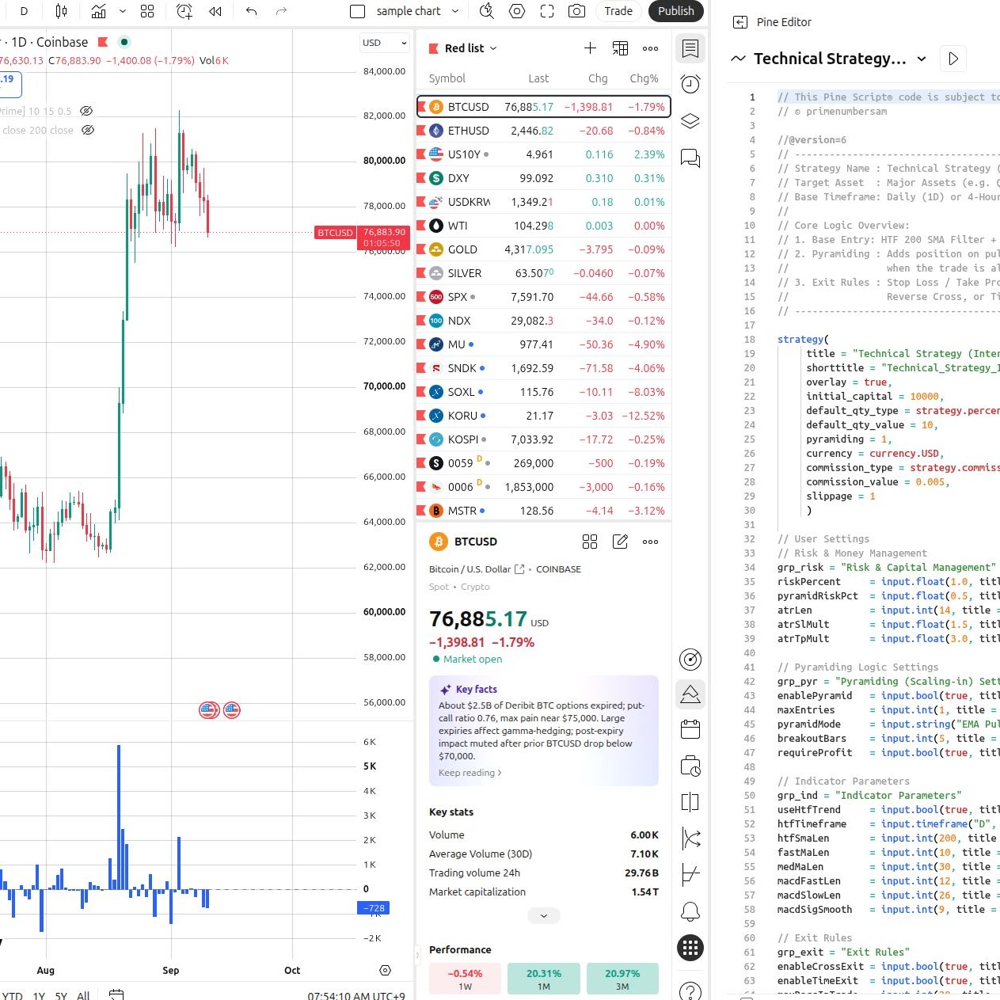

# TradingView Pine Script v6 Examples

TradingView 무료 플랜의 차트당 지표 개수 제한을 우회하기 위해, 여러 지표를 하나의 Custom Indicator로 통합하거나 `strategy()` 함수로 진입/청산 로직을 묶어 백테스팅까지 수행할 수 있는 Pine Script v6 예시 모음이다.

[pinescript.md](./pinescript.md)의 예시 코드를 쉽게 복사해 사용할 수 있도록 [index.html](./index.html)에 Bento Card Grid 및 Neobrutalism 스타일의 단일 파일 웹 페이지로 정리했다.

## 수록 스크립트 (3종)

1. Candle Amplitude (`indicator`): 당일 봉 진폭과 전일 포함 2개 봉 통합 진폭(%)을 Status Line 및 Data Window에 표시한다.
2. Technical Strategy (Basic) (`strategy`): Bollinger Bands + RSI 결합 평균회귀 진입과 ATR 기반 손절/익절(Bracket Exit) 백테스트 전략이다.
3. Technical Strategy (Intermediate) (`strategy`): 상위 타임프레임(HTF) 200 SMA 필터, EMA 10/30 크로스, MACD, 변동성 필터 및 피라미딩(Scaling-in), 보유 기간 제한 청산을 구현한 추세추종 전략이다.

## 사용 방법

1. 브라우저에서 [index.html](./index.html)을 연다.
2. 원하는 스크립트 카드의 `복사` 버튼을 누른다.
3. TradingView 차트 하단 `Pine Editor`에 붙여넣고 `Add to chart`를 클릭한다.
