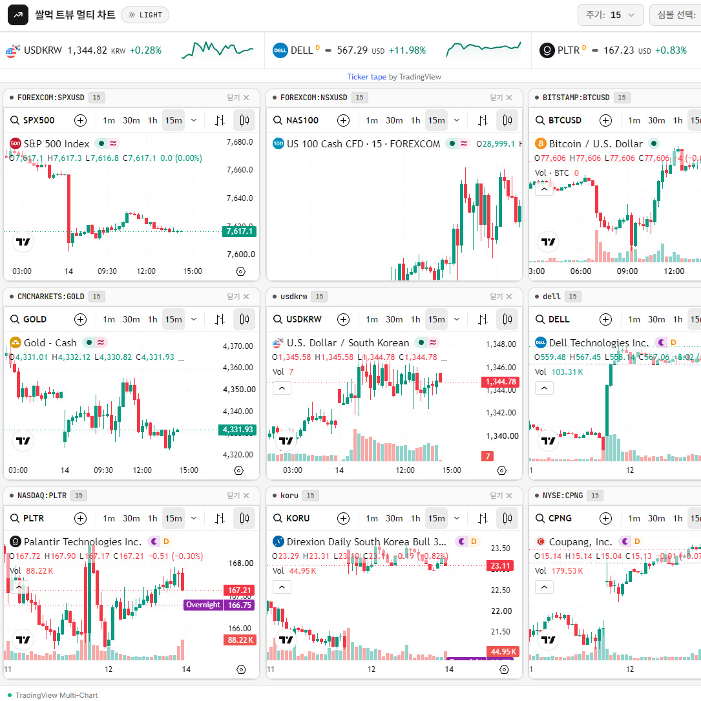

# TradingView Multi-Chart (SFA)

어떠한 클라이언트 OS(Windows, macOS, Linux, iOS, Android)에서도 별도의 빌드나 서버 설치 없이 브라우저로 [index.html](./index.html) 파일만 열어 구동하는 초경량 단일 파일 애플리케이션(Single File Application)이다.

클라이언트 사이드(Client-side)에서 TradingView 공식 임베드 위젯을 직접 호출하는 래퍼(Wrapper) 구조로, TradingView 유료 플랜 없이도 무료로 멀티 차트 레이아웃을 구성할 수 있다.

## 주요 기능

- 제로 빌드(Zero-build) 단일 파일: 백엔드 서버, 패키지 매니저, 번들러 없이 HTML 파일 단독 실행
- 최대 9개 멀티 차트 그리드: 선택된 심볼 수(1~9개)에 맞춰 데스크톱 및 모바일 반응형 그리드 자동 배치
- 상단 티커 테이프(Ticker Tape): 선택된 심볼의 실시간 시세 흐름 표시
- 주기(Interval) 및 심볼(Symbol) 커스터마이징: 기본 프리셋 외 사용자 정의 타임프레임과 종목 코드 추가/제거
- 다크 / 라이트 테마 전환 및 `localStorage` 기반 설정 자동 영속화
- 모바일 터치 스크롤 보호: 차트 위에서 손가락 스와이프 시 페이지 스크롤을 방해하지 않도록 `스크롤 모드`와 `차트 조작중` 전환 지원

## 사용 방법

1. [index.html](./index.html) 파일을 다운로드하거나 로컬에 저장한다.
2. 데스크톱 또는 모바일 웹 브라우저에서 해당 파일을 직접 연다.
3. 우측 상단 메뉴에서 `주기`와 `심볼 선택`(최대 9개)을 지정하여 차트를 조회한다.
